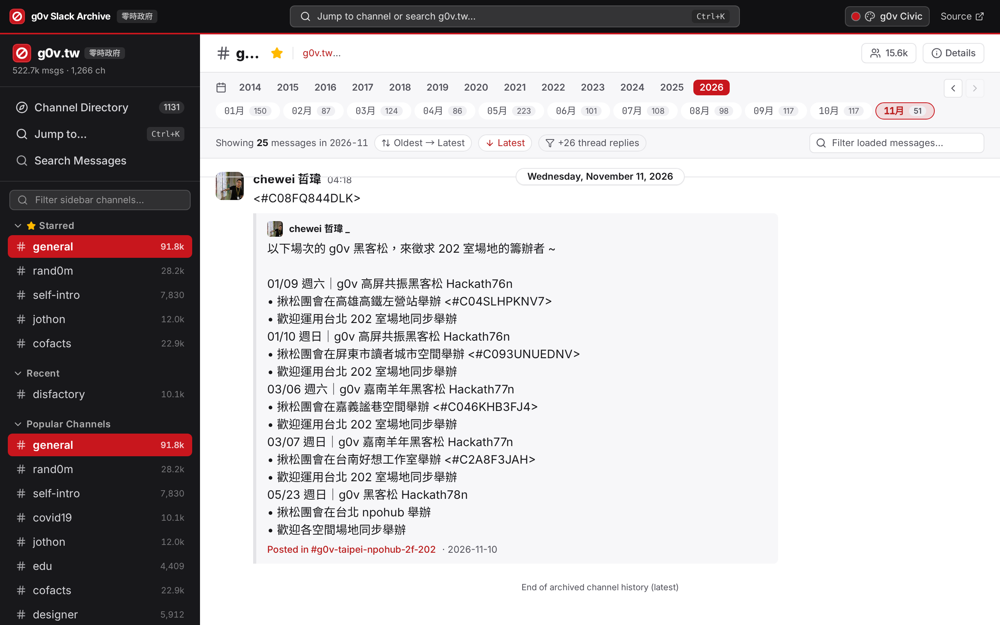
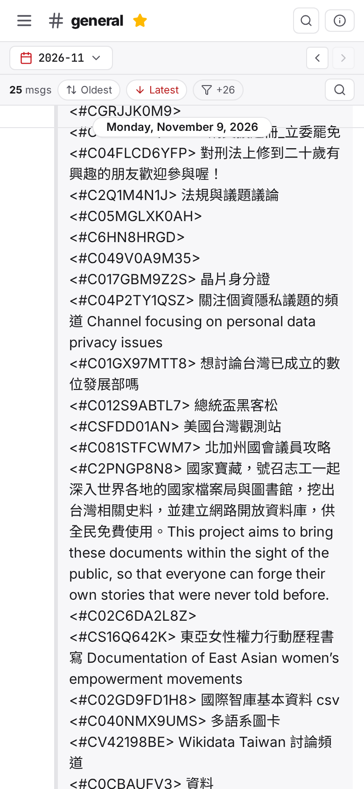

# g0v Slack Archive Viewer

A Slack-style, mobile-friendly frontend and Node/Express BFF proxy for browsing [g0v-slack-archive](https://g0v-slack-archive.g0v.ronny.tw/) ([`ronnywang/g0v-slack-archive`](https://github.com/ronnywang/g0v-slack-archive)).

## Screenshots

### Desktop (`g0v Civic` Theme)


### Mobile (`390×844`)


## Features

- **g0v-Specific Themes**: Built around g0v's visual identity with **g0v Civic** (default carbon ink & g0v crimson), **g0v Night** (dark hacker mode), **g0v Jothon** (summit jade & warm paper), and **Slack Classic**, switchable from the top theme picker, mobile sidebar, or Command Palette.
- **Slack-Style 3-Pane & Mobile Layout**: Workspace sidebar with starred, recent, and popular channels; central message feed; full-screen mobile / slide-over desktop **Thread** and **Channel Details** drawers; collapsible mobile timeline and compact header chrome.
- **Latest-at-Bottom Order & Bidirectional Infinite Loading**: Opens channels scrolled to the newest messages at the bottom, and seamlessly prepends/appends adjacent months as you scroll with pixel-accurate scroll anchoring (plus an `Oldest → Latest` / `Latest → Oldest` toggle).
- **Command Palette & Quick Switcher (`⌘K` / `Ctrl+K`)**: Instant fuzzy channel switching across 1,131+ channels, quick actions, and a `Tab`-switchable full-text message search with channel facet filters (`⌘⇧K` / `Ctrl+Shift+K` opens the Channel Directory).
- **Channel Directory**: Browse, search, and sort all archived public channels by members, message count, recent activity, or name.
- **Year / Month Timeline Bar**: Jump across years and months with per-month message counts, Previous/Next navigation, and quick filtering across loaded messages.
- **Threads, Reactions & Rich Content**: Threaded replies drawer, reaction emoji counts with user tooltips, clickable internal `#channel` links, link unfurl / forwarded message cards, and image lightbox previews.

## How Upstream Data Is Accessed

`https://g0v-slack-archive.g0v.ronny.tw/` exposes partial JSON APIs (`/index/count`, `/index/getmessage`), while full channel lists, monthly pagination, search, threads, reactions, and `title` JSON metadata live in server-rendered HTML (`IndexController.php` / `channel.phtml` / `message.phtml` / `search.phtml`).

The Express backend ([`server/scraper.ts`](./server/scraper.ts) & [`server/app.ts`](./server/app.ts)):
- Proxies `/index/count` -> `GET /api/stats`
- Parses `/` channel index -> `GET /api/channels`
- Parses `/index/channel/:id[/:month]` -> `GET /api/channel/:id[/:month]`
- Parses `/index/search?q=...` -> `GET /api/search?q=...` (enriching user profiles from cached channel visits)
- Proxies `/index/file?url=...` -> `GET /api/file?url=...` with magic-byte `Content-Type` detection (since upstream serves Slack files without an image MIME header)

## Integrating as a Beta Frontend for `ronnywang/g0v-slack-archive`

The React frontend (`src/`) only talks to the `/api/*` endpoints defined in [`src/api.ts`](./src/api.ts) and [`src/types.ts`](./src/types.ts). If `ronnywang/g0v-slack-archive` exposes matching JSON endpoints (or accepts static build output from `vite build`), the React frontend can run directly against the PHP backend without the HTML-scraping BFF layer.

## Getting Started

```bash
npm install
npm run dev
```

- Frontend dev server: `http://localhost:5173` (proxies `/api/*` to `:3456`)
- Backend API server: `http://localhost:3456`

### Production Build

```bash
npm run build
npm start
```

Serves both the compiled React app and `/api/*` from `http://localhost:3456` (configurable via `PORT`).

### Vercel Deployment

Includes [`api/index.ts`](./api/index.ts) and [`vercel.json`](./vercel.json) so the Vite frontend and Express `/api/*` endpoints deploy together on Vercel with CDN `Cache-Control` headers.

## License

[MIT](./LICENSE)
